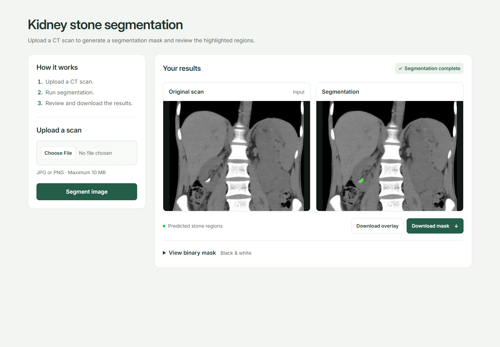
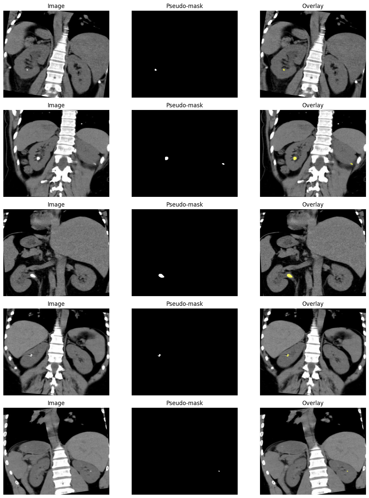
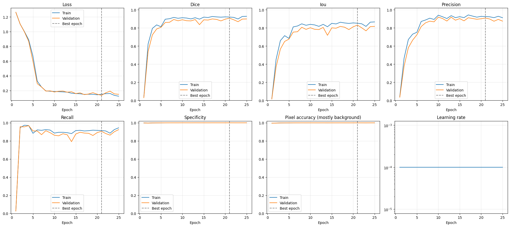
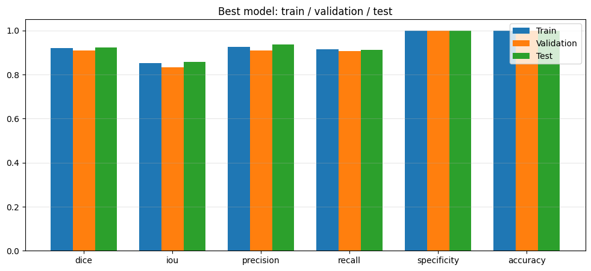
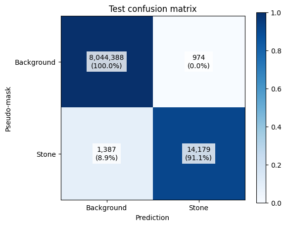
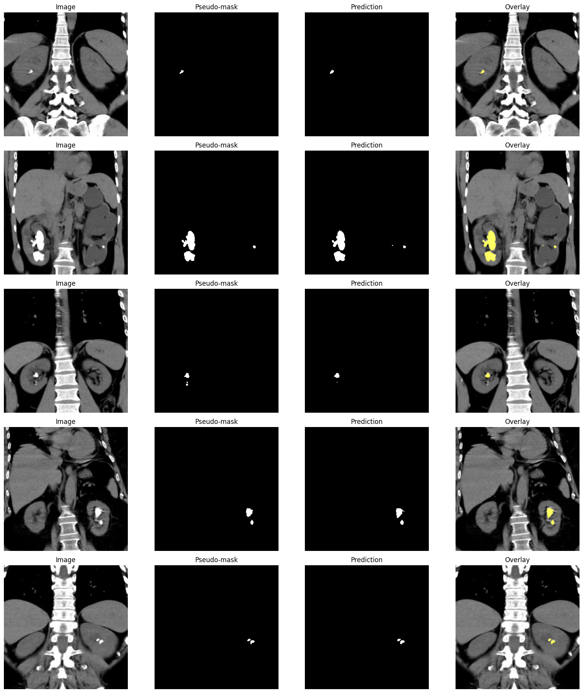

# Kidney Stone Segmentation App

A web application for segmenting kidney stones in CT images using a U-Net model with a ResNet50 encoder.

This project originally started as a **graduation thesis**, for which a desktop application for kidney stone segmentation was developed using PyQt6. The project has since been extended with a **Flask web application**, bringing image upload, segmentation, and result visualization into the browser. Model training is performed separately in Google Colab.

## Project structure

```text
kidney-stones-segmentation-app/
├── demo/                         # Screenshots, plots, and recorded metrics
├── notebooks/
│   └── model_training.ipynb       # Google Colab training pipeline
├── src/
│   ├── app.py                    # Flask routes, uploads, and result files
│   ├── segmentator.py            # Model loading, preprocessing, and inference
│   ├── templates/
│   │   └── index.html            # Upload and result interface
│   └── static/
│       ├── css/style.css         # Responsive layout and typography
│       ├── fonts/                # Locally hosted Inter font and its license
│       ├── models/model.pth      # Trained weights; not tracked by Git
│       ├── uploads/              # Uploaded scans; not tracked by Git
│       └── results/              # Generated masks and overlays; not tracked by Git
├── requirements.txt
├── .gitignore
└── README.md
```




## Features

- Upload JPG or PNG images up to 10 MB.
- Compare the original scan and the segmentation overlay side by side.
- Inspect the binary mask and download the mask or overlay as PNG.
- Use the responsive interface on desktop and mobile devices.
- Run inference on the CPU; a local GPU is not required.

The interface uses HTML, CSS, and locally hosted Inter fonts. Flask handles uploads and responses, while the PyTorch model and image processing are implemented separately in `src/segmentator.py`.


## Run locally

The current dependency set has been tested with **Python 3.14** on Windows.

### 1. Clone the repository and create an environment

```bash
git clone https://github.com/pprykhodko/kidney-stones-segmentation-app.git
cd kidney-stones-segmentation-app
python -m venv .venv
```

### 2. Add the model weights

Create `src/static/models/` if it does not exist, and place the trained checkpoint there:

```text
src/static/models/model.pth
```

**The weights are excluded from Git and are not included when cloning the repository.** Obtain `model.pth` by running the [training notebook in Colab](https://colab.research.google.com/drive/1O0uo5r8oXhossYm_1wzTceZzpH3ZDv8H?usp=sharing) and downloading the saved checkpoint.

The file must contain the PyTorch `state_dict` for **U-Net / ResNet50, `in_channels=1`, `classes=1`**. A checkpoint trained with a different encoder or a different number of input channels will not load into this model.

### 3. Install dependencies and start the application

Windows PowerShell:

```powershell
.\.venv\Scripts\python.exe -m pip install -r requirements.txt
.\.venv\Scripts\python.exe src/app.py
```

macOS / Linux:

```bash
.venv/bin/python -m pip install -r requirements.txt
.venv/bin/python src/app.py
```

Open [http://127.0.0.1:5000](http://127.0.0.1:5000), choose a scan, and click **Segment image**. The first prediction loads the weights; subsequent requests reuse the loaded model.

## Model

The model performs **2D binary semantic segmentation**: each pixel is assigned to the predicted stone region or background.

| Component | Configuration |
| --- | --- |
| Architecture | U-Net, implemented with `segmentation-models-pytorch` 0.5.0 |
| Encoder | ResNet50, initialized with ImageNet weights during training |
| Encoder feature channels | 64, 256, 512, 1024, 2048 |
| Decoder | Five upsampling blocks with skip connections |
| Decoder output channels | 256, 128, 64, 32, 16 |
| Segmentation head | 3×3 convolution from 16 channels to 1 channel |
| Input | Grayscale image, shape `N × 1 × 256 × 256` |
| Output | One-channel logits, followed by sigmoid and thresholding |
| Threshold | 0.5 |
| Parameters | 32,514,833 |

The encoder extracts features at progressively lower resolutions. The decoder restores spatial resolution and combines these features with the corresponding encoder features through skip connections. The final convolution produces a score for each pixel.

### Image preprocessing and prediction

1. Read the image in grayscale.
2. Resize it to **256×256** using bilinear interpolation.
3. Normalize pixel values with `image / 127.5 - 1.0`, producing values in `[-1, 1]`.
4. Run the model in evaluation mode with gradient computation disabled.
5. Apply sigmoid and classify probabilities `>= 0.5` as foreground.
6. Resize the binary mask to the original image dimensions using nearest-neighbor interpolation.

The application returns a binary PNG mask (`0` for background, `255` for foreground) and a green overlay with 75% opacity inside the predicted region. No random augmentation or CLAHE is applied during inference.

## Dataset and mask generation

The project uses [Kidney Stone Images with Bounding Box Annotations on Kaggle](https://www.kaggle.com/datasets/safurahajiheidari/kidney-stone-images).

The supplied archive contains **1,300 images**, each 391×320 pixels, with bounding-box annotations in YOLO format. It does not contain expert pixel-level segmentation masks.

| Split | Images | Annotated boxes |
| --- | ---: | ---: |
| Train | 1,054 | 2,278 |
| Validation | 123 | 325 |
| Test | 123 | 224 |

The notebook builds training targets from the supplied annotations:

1. Convert the normalized bounding boxes to image coordinates.
2. Run **GrabCut** on a crop around each box, retaining surrounding background.
3. Use **Otsu thresholding** inside the box if GrabCut fails or returns an empty mask.
4. Combine all object masks into one binary mask for the complete image.

**No YOLO detector is trained or used in the current pipeline.** Only the annotation format is YOLO. Mask generation runs on the CPU.

<details>
<summary>Examples of generated pseudo-masks</summary>



</details>

## Training in Google Colab

- [Repository notebook](notebooks/model_training.ipynb): the training implementation.
- [Google Colab notebook with saved outputs](https://colab.research.google.com/drive/1O0uo5r8oXhossYm_1wzTceZzpH3ZDv8H?usp=sharing): the recorded run used for the metrics and figures below.

The recorded run used the following settings:

| Setting | Value |
| --- | --- |
| Training hardware | NVIDIA Tesla T4 in Google Colab |
| Epochs | 25 |
| Batch size | 4 |
| Initial learning rate | 0.0001 |
| Optimizer | Adam |
| Loss | DiceLoss + BCEWithLogitsLoss |
| Scheduler | ReduceLROnPlateau on validation loss, factor 0.5, patience 3 |
| Training augmentation | Random horizontal flip, probability 0.5 |
| Seed | 42 |
| Checkpoint selection | Lowest validation loss |
| Selected checkpoint | Epoch 21, validation loss 0.1355 |

To train the model, open the notebook in Colab, select a GPU runtime, and run the cells in order. Upload the dataset ZIP when prompted. After training, download `/content/model.pth` and place it in the application's model directory.

Image masks are resized using nearest-neighbor interpolation. Training curves are evaluated on the training set without random flips and on the validation set, using the same fixed threshold. The test set is evaluated after restoring the checkpoint selected on validation loss.

## Results

The values below are taken directly from the **saved Colab outputs for the selected checkpoint**, rounded to four decimal places. They describe the current training run, rather than the earlier thesis experiments.

| Metric | Train | Validation | Test |
| --- | ---: | ---: | ---: |
| Dice | 0.9201 | 0.9078 | **0.9231** |
| IoU | 0.8521 | 0.8312 | **0.8573** |
| Precision | 0.9257 | 0.9092 | 0.9357 |
| Recall / sensitivity | 0.9147 | 0.9064 | 0.9109 |
| Specificity | 0.9998 | 0.9998 | 0.9999 |
| Pixel accuracy | 0.9997 | 0.9996 | 0.9997 |
| Loss | 0.1497 | 0.1355 | 0.1426 |

Metrics are calculated from global pixel-level TP, FP, FN, and TN counts over each split at **256×256** resolution. They are not averages of individual batch scores. Recall here measures target pixels recovered, not the proportion of patients or individual stones detected.

**Interpretation:** the reference masks are automatically generated pseudo-masks. These results measure agreement with those masks, not agreement with expert-drawn contours. Background pixels dominate the images, so pixel accuracy alone is not a useful summary of segmentation quality; Dice and IoU are more informative.

### Training curves

Loss, Dice, IoU, precision, recall, specificity, pixel accuracy, and learning rate across 25 epochs. The dashed line marks epoch 21.



### Comparison across dataset splits



### Test confusion matrix

Cells show pixel counts and row-normalized percentages. The recorded test evaluation contains 14,179 true-positive, 974 false-positive, 1,387 false-negative, and 8,044,388 true-negative pixels. Percentages inside the figure are rounded to one decimal place.



### Segmentation examples

The columns show the input image, generated pseudo-mask, model prediction, and overlay for five test images.




## Scope and limitations

- The model processes 2D JPG/PNG images, not DICOM studies or complete 3D volumes.
- The dataset split is used as supplied; patient-level independence is not established by the notebook.
- Validation and test annotations contain no empty label files, so the reported scores do not establish performance on stone-free scans.
- The original aspect ratio is changed when resizing inputs to 256×256; very small objects can lose detail.
- The model uses automatically generated targets and has not been evaluated here against an independent expert segmentation set.

## Licenses

### Dataset

The dataset archive identifies its source as [TEZ_ROI_AUG v3 on Roboflow](https://universe.roboflow.com/tez-nwkf5/tez_roi_aug/dataset/3), distributed under **CC BY 4.0**. The CT images shown in the demonstrations come from this dataset.

### Font

The Inter font is bundled under the [SIL Open Font License](src/static/fonts/OFL.txt).
